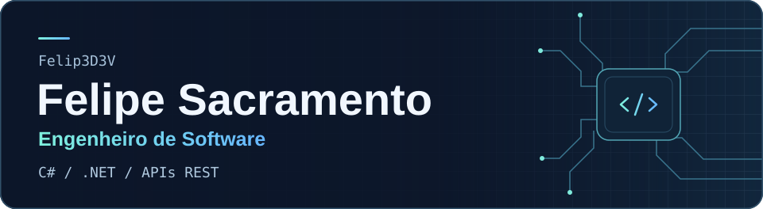

**Sergipe, Brasil** · Graduado em Sistemas de Informação pela Universidade Federal de Sergipe (UFS)

Desenvolvo sistemas web com **C# e .NET**, da modelagem do banco de dados à implementação das regras de negócio, das APIs e dos testes. Também tenho experiência com **Power BI** para análise e visualização de dados.

## Projetos em destaque

| Projeto | O que faz | Tecnologias |
| :--- | :--- | :--- |
| **[BiotLab](https://github.com/Felip3D3V/BiotLab)** | Sistema de apoio à gestão de biotérios acadêmicos, com controle de gaiolas, experimentos e insumos. Desenvolvido como TCC na UFS. | C# · ASP.NET Core MVC · EF Core · MySQL |
| **[Eventos](https://github.com/Felip3D3V/eventos)** | Sistema web para gestão de eventos, inscrições e acompanhamento da frequência dos participantes. | C# · ASP.NET Core · EF Core · MySQL |
| **[CompilerSQL](https://github.com/Felip3D3V/CompilerSQL)** | Compilador para um subconjunto de SQL, com análise léxica, sintática e semântica e geração de código Assembly MIPS. | Python · PLY · MIPS |

## Tecnologias e práticas

- **Desenvolvimento web** · `C#` `.NET` `ASP.NET Core MVC` `APIs REST` `JavaScript`
- **Persistência e análise de dados** · `SQL` `MySQL` `Entity Framework Core` `Power BI`
- **Testes e versionamento** · `MSTest` `Moq` `Git` `GitHub`

[Ver todos os repositórios](https://github.com/Felip3D3V?tab=repositories) · [Contato por e-mail](mailto:Felipe.m_s@hotmail.com)
